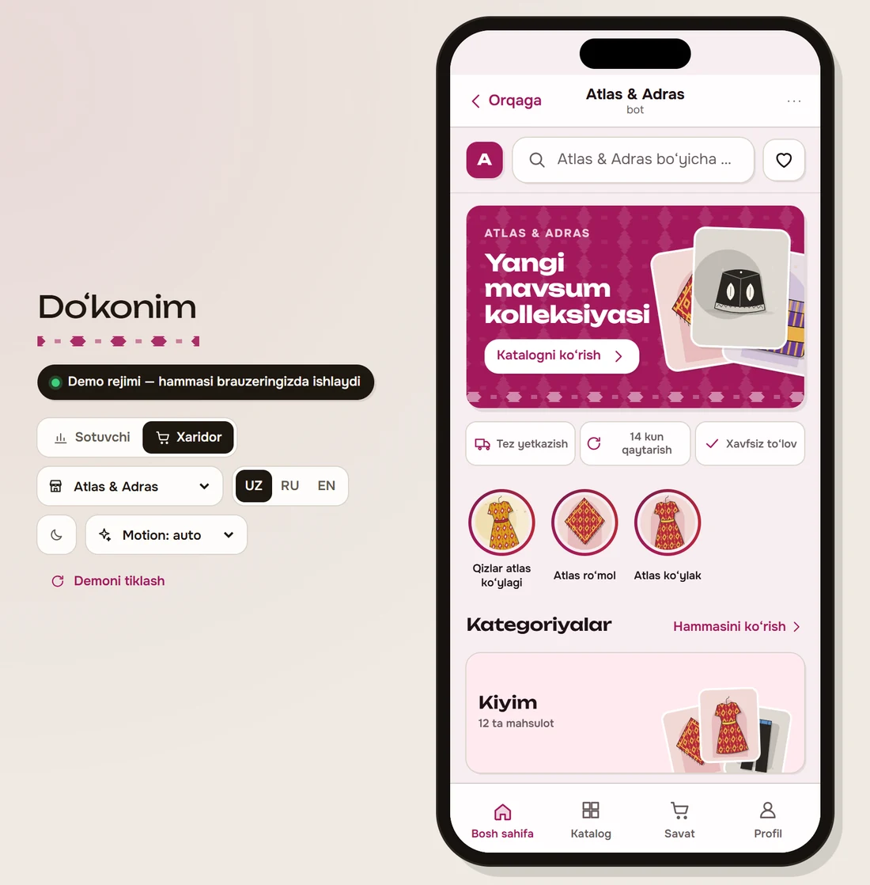
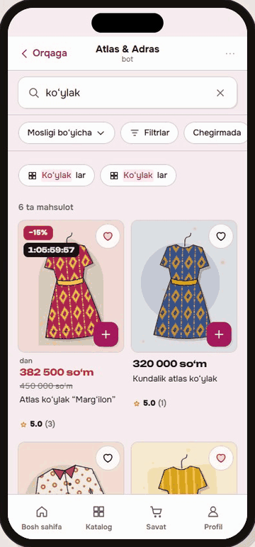
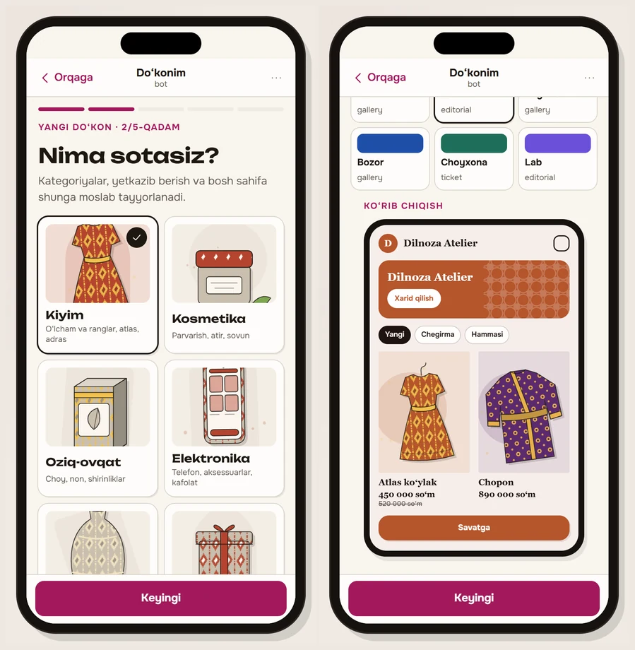
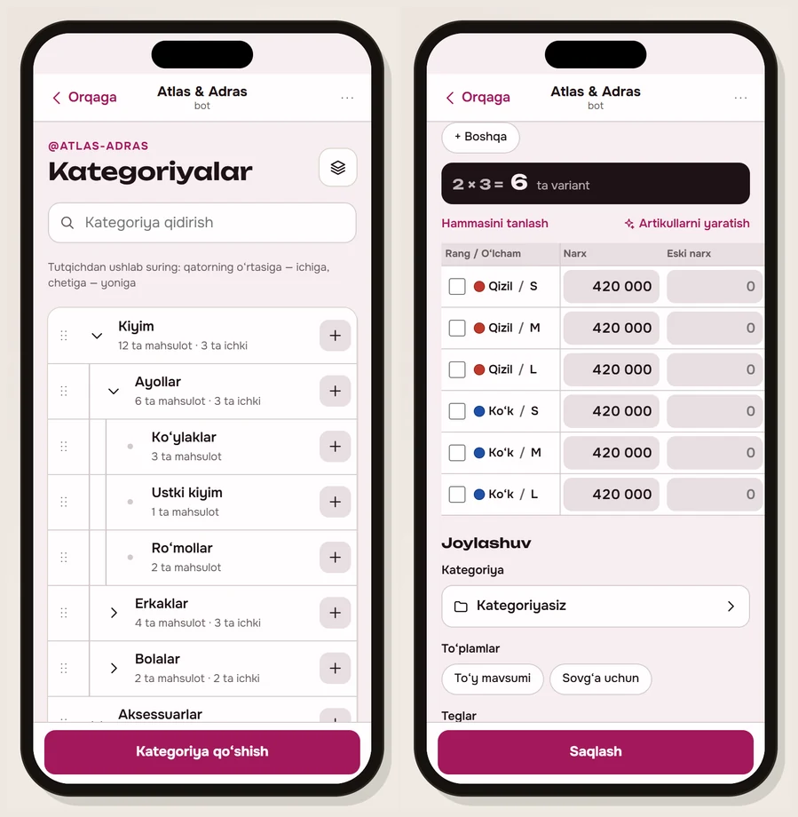
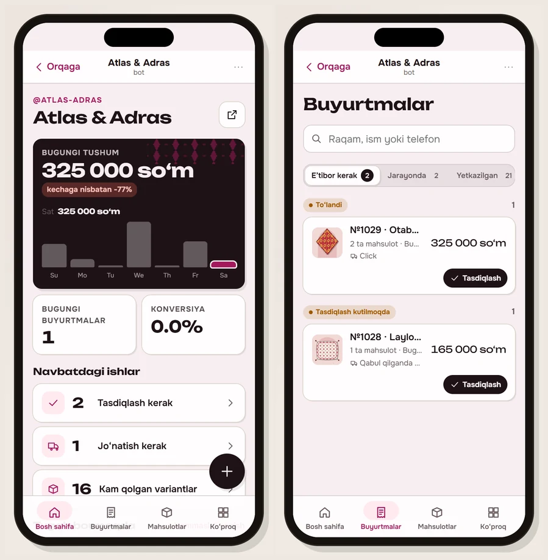
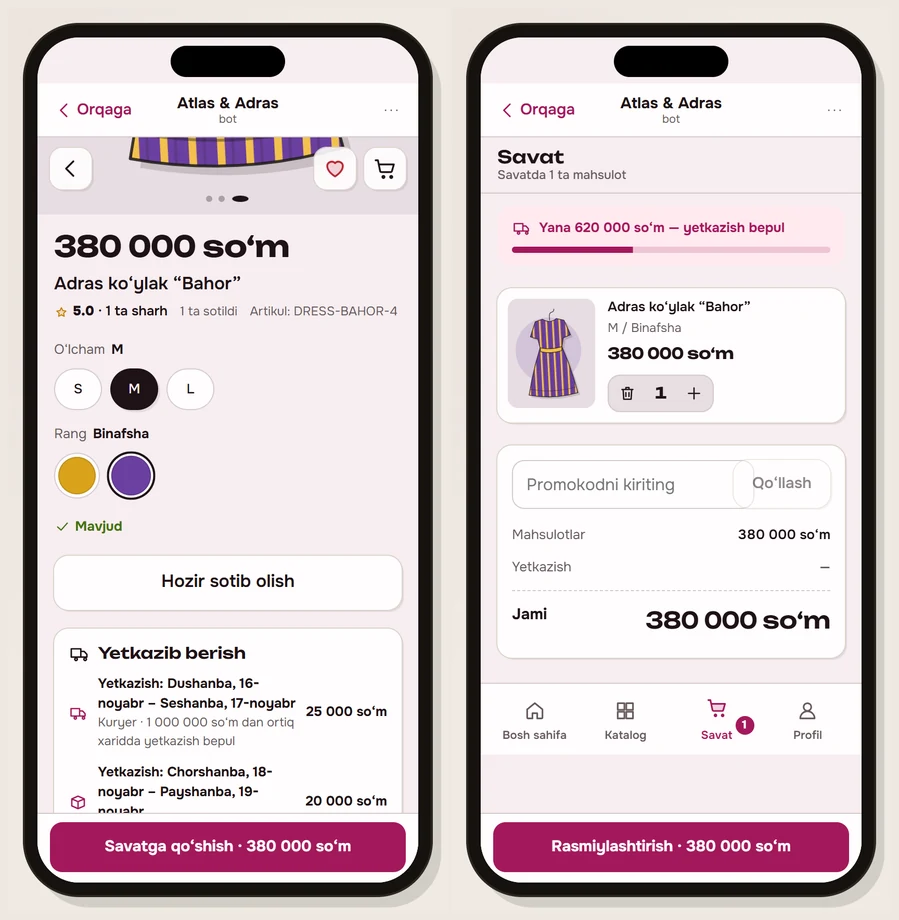
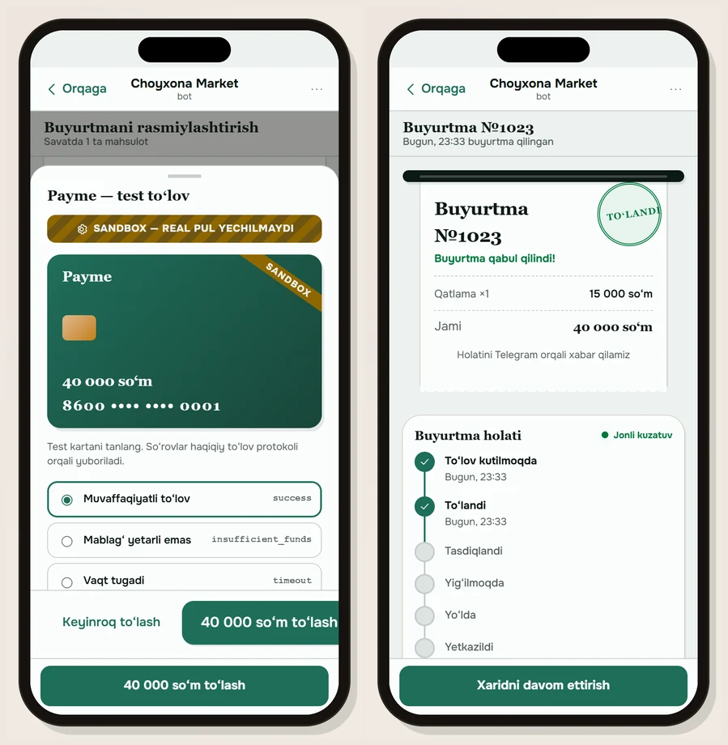
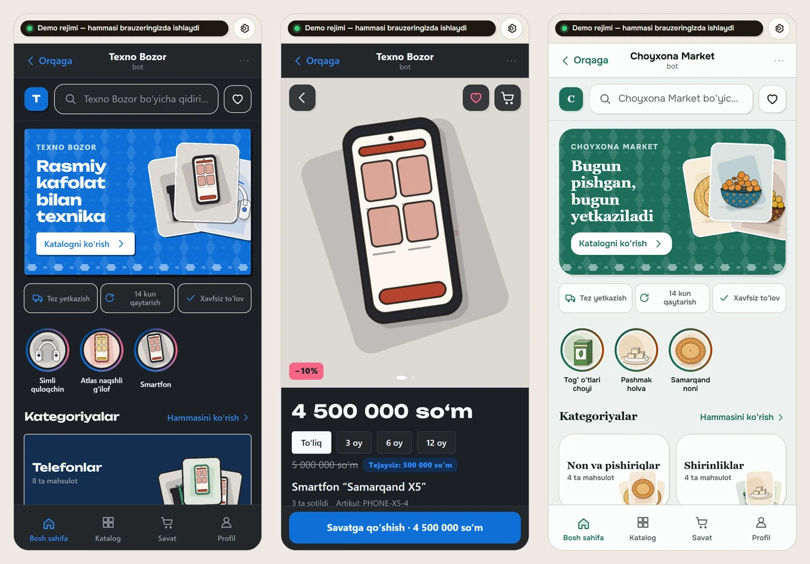
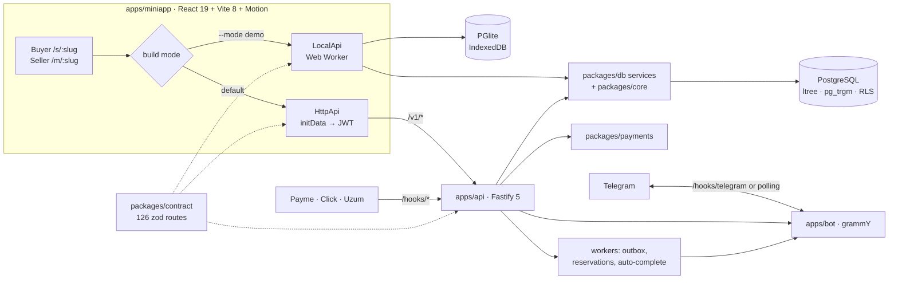

# Do'konim

[English](README.md) · [O'zbekcha](README.uz.md)

[](https://xoliddev.github.io/dokonim/)
[](https://github.com/xoliddev/dokonim/actions/workflows/ci.yml)
[](LICENSE)

Do'konim ("my shop" in Uzbek) is a multi-tenant store builder that runs as a Telegram Mini App. A seller opens the bot,
goes through a five-step wizard and has a themed storefront with a nested catalogue, variants, discounts, shipping and
local payment methods (Payme, Click, Uzum, Telegram Stars, cash on delivery). Buyers shop inside Telegram without
installing anything. The live demo runs the real backend code in your browser (PostgreSQL compiled to WebAssembly in a
Web Worker), so you can create a store, place an order, pay in sandbox and confirm it as the seller with no server and
no Telegram account. The interface is in Uzbek, Russian and English.

<p align="center">
  
  &nbsp;
  
</p>

## Screenshots

| Seller | |
|---|---|
|  |  |
| **Wizard** with a live preview of the storefront | **Category tree** and **variant matrix** (2 × 3 = 6 variants) |
|  | |
| **Dashboard** and **orders queue** | |

| Buyer | |
|---|---|
|  |  |
| **Product page** and **cart** | **Sandbox payment sheet** and **receipt stamp** |

<p align="center">
  <br>
  <sub>At 375 px the app goes full-bleed. Three seeded stores, three theme presets: Volt (dark), Volt product page, Choyxona.</sub>
</p>

## Features

### For sellers (`/m/:slug`)

- **Create-store wizard** in five steps: name and address (live slug check), business type, brand (logo, colour, font
  pair, theme preset), first product, payment methods. A live storefront preview follows every change, and the last
  screen gives the store link and a QR code.
- **Dashboard**: today's revenue, orders and conversion, a 7-day chart, and an action queue (orders to confirm, to
  ship, low-stock variants).
- **Products**: draft / active / archived, per-language titles, media editor, up to three options that generate a
  **variant matrix** with bulk price, compare-at price and SKU editing, category and collections, bulk actions.
- **Categories of any depth**: tree with drag to reorder or nest, add a child, rename, move through a searchable picker,
  delete with a strategy for the children and products. Cycles are rejected in `packages/core`.
- **Collections**: manual or rule based.
- **Orders**: queue grouped by status, order detail with a timeline, transitions driven by the order state machine,
  internal notes, refunds.
- **Promo codes**: percent, fixed amount, free shipping, buy X get Y.
- **Settings**: theme editor with a live preview (8 presets: Atlas, Choyxona, Lab, Volt, Kashta, Registon, Tun, Bozor;
  contrast is checked and corrected), payment providers with sandbox / live mode and write-only credentials, shipping
  zones and methods, store details, staff invites and roles (owner, admin, manager, catalogue editor, order operator,
  viewer).

### For buyers (`/s/:slug`)

- **Store home** built from theme sections: hero banner, stories, category cards, collections, flash sales with a
  countdown, product carousels.
- **Catalogue** with category drill-down and breadcrumbs, collections, **search** with a filter sheet (price range,
  in stock, on sale, rating, option values) and sorting.
- **Product page**: gallery, variant picker that knows which combinations are in stock, installment chips (3 / 6 / 12
  months), delivery-date promise, specs, reviews with a histogram, questions, related and "bought together" products.
- **Signature motion**: the product image flies into the cart icon on add ("The Arc"), the grid card morphs into the
  product page. Motion has three tiers and respects `prefers-reduced-motion`.
- **Cart**: quantity steppers, free-delivery progress, promo codes, stock and price re-validation.
- **One-screen checkout**: contact, address, delivery method, payment method, order note.
- **Receipt and tracking**: printed-receipt animation with a stamp, live status timeline, pickup code, cancel and reorder.
- **Wishlist, My orders, profile**, Uzbek / Russian / English.

## Architecture



- **One route table.** `packages/contract` declares all 126 methods (verb, path, auth, zod input). The API registers
  them, `HttpApi` calls them, and `LocalApi` dispatches them to the same `@dokonim/db` services inside a Web Worker.
- **Same SQL everywhere.** One migration set runs on PostgreSQL (`pg`) and on PGlite. Categories are an `ltree`
  column, search uses `pg_trgm`, and every application query runs as the non-owner role `dokonim_app` with
  `app.store_id` / `app.user_id` set, so row-level security enforces tenant isolation.
- **Pure core.** Pricing, the category tree, order / payment state machines, theming, delivery dates, initData
  validation and money (integer tiyin, 1 soʻm = 100) live in `packages/core` with no I/O.
- **The bot runs inside the API process** when `BOT_TOKEN` is set: webhook mode when `BOT_WEBHOOK_SECRET` is set,
  long polling otherwise. Background workers deliver the notification outbox, expire stock reservations every minute
  and auto-complete delivered orders hourly.

## Payments

Each store enables its own providers. Credentials are write-only in the seller UI and stored encrypted with a
key-encryption key (`CREDENTIALS_KEK`). Every provider config has a **sandbox / live** mode, and new stores start in
sandbox.

| Provider | Flow | Currencies | Refunds | Webhook |
|---|---|---|---|---|
| Payme | redirect, Merchant API (JSON-RPC) | UZS | full (`CancelTransaction`) | `POST /hooks/payme/:storeId` |
| Click | redirect, SHOP-API prepare / complete (md5 signatures) | UZS | manual, in the Click cabinet | `POST /hooks/click/:storeId/:action` |
| Uzum | redirect, Merchant API (Basic auth) | UZS | full (`reverse`) | `POST /hooks/uzum/:storeId/:action` |
| Telegram Payments | invoice from the bot, third-party provider token | UZS, USD | at the provider | `POST /hooks/telegram` |
| Telegram Stars | invoice, digital goods only | XTR | full (`refundStarPayment`) | `POST /hooks/telegram` |
| Cash on delivery | offline | UZS, USD | manual | none |
| Bank transfer | offline | UZS, USD | manual | none |

Checkout only offers methods that fit the cart: digital goods are paid with Stars only, Stars are never offered for
physical goods, and the cart currency must be one the provider accepts.

**Sandbox mode.** The simulators in `packages/payments/src/sandbox.ts` play the provider's side and call our real webhook
handlers with genuine protocol messages: Payme JSON-RPC with a correct Basic header, Click form posts with real md5
signatures, Uzum JSON with Basic auth, Telegram Bot API updates. In the sandbox sheet the buyer picks a test card
scenario (success, insufficient funds, timeout), and the order and payment state machines react exactly as they would
in production. No money moves.

## Real vs simulated in the demo

The demo at <https://xoliddev.github.io/dokonim/> is a static build (`vite build --mode demo`) with no server.

| Part | In the demo | How |
|---|---|---|
| Database | **Real** PostgreSQL engine | PGlite (Postgres compiled to WebAssembly) in a Web Worker, persisted in IndexedDB; in memory when IndexedDB is unavailable |
| Schema, migrations, RLS | **Real**, same SQL as the server | the same `@dokonim/db` migrations and services; queries run as `dokonim_app` |
| Business logic | **Real** | the same `packages/core` and `@dokonim/db` code the API uses |
| Seed data | Pre-baked | three stores (Atlas & Adras, Choyxona Market, Texno Bozor) with orders and reviews, loaded from a snapshot and shifted to the current time |
| Login | **Real algorithm**, demo key | initData is HMAC-signed with a demo bot token and checked by `core` validation |
| Telegram | Simulated outside Telegram | phone frame with a Telegram-style header, MainButton and BackButton; the real WebApp is used when opened inside Telegram |
| Payments | Simulated provider side | sandbox simulators call the real webhook handlers; no money moves |
| Bot notifications | Not sent | outbox rows are written and the order timeline refreshes live, but no message leaves the browser |
| Background jobs | **Real**, in the worker | reservation expiry and auto-complete run every 60 s |
| Your data | Local only | stays in this browser; the demo bar has "Reset demo" |

The demo bar switches between seller and buyer, between stores, language (uz / ru / en), light / dark and the motion
tier.

## Quick start

Requirements: Node.js 22 or newer, npm (workspaces). PostgreSQL is only needed for the API.

```bash
npm ci
```

### Browser demo (no backend)

```bash
npm run build:demo                     # bakes the demo database snapshot, then vite build --mode demo
npm run preview -w @dokonim/miniapp    # http://localhost:4173/dokonim/
```

For hot reload, run Vite in demo mode: `npm run dev -w @dokonim/miniapp -- --mode demo` and open
<http://localhost:5173/dokonim/>. Without a baked snapshot the worker seeds the stores in the browser on first load,
which is slower.

### API and Mini App locally

The API reads its configuration from the environment and does not load `.env` by itself.

```bash
cp .env.example .env                   # then set DATABASE_URL, PUBLIC_URL, MINIAPP_URL, JWT_SECRET, CREDENTIALS_KEK
npx tsx --env-file=.env apps/api/src/main.ts      # migrations run on boot; GET /healthz, GET /v1/openapi.json
VITE_API_URL=http://localhost:8080 npm run dev    # Mini App on http://localhost:5173 against the API
```

The API listens on port 8080 by default, while the Mini App dev server points at `http://localhost:3000` unless
`VITE_API_URL` is set. Login uses Telegram initData, so outside the demo the Mini App has to be opened from your bot.
`npm run migrate -w @dokonim/api` runs the migrations on their own.

### Docker

`docker-compose.yml` starts PostgreSQL 17 and the API (the bot runs inside the API process when `BOT_TOKEN` is set).
The Mini App is a static build and is not part of the compose file.

```bash
cp .env.example .env                   # fill in JWT_SECRET and CREDENTIALS_KEK (openssl rand -hex 32)
docker compose up --build              # API on http://localhost:8080
```

## Configuration

The API validates its environment with zod on boot (`apps/api/src/env.ts`) and exits with one message that lists every
problem, without echoing values. The bot has no configuration of its own: it runs inside the API process and gets its
token from the API. Copy [`.env.example`](.env.example) and fill it in.

| Variable | Required | Default | Purpose |
|---|---|---|---|
| `NODE_ENV` | no | `development` | `development`, `test` or `production`. In production `PUBLIC_URL` must be https and webhook mode needs `BOT_WEBHOOK_SECRET` |
| `PORT` | no | `8080` | HTTP port |
| `HOST` | no | `0.0.0.0` | bind address |
| `DATABASE_URL` | **yes** | | `postgres://` connection string; the role runs the migrations |
| `DATABASE_POOL_MAX` | no | `10` | pool size (1–100) |
| `PUBLIC_URL` | **yes** | | public URL of the API (webhook URLs shown to sellers, OpenAPI `servers`) |
| `MINIAPP_URL` | **yes** | | URL where the Mini App is hosted (`web_app` buttons) |
| `MINIAPP_SHORT_NAME` | no | `shop` | Mini App short name registered in BotFather, for `t.me/<bot>/<short_name>` links |
| `BOT_TOKEN` | no | | bot token from @BotFather. Without it Telegram login, notifications and invoices are off |
| `BOT_USERNAME` | with `BOT_TOKEN` | | bot username without `@`, used in deep links |
| `BOT_WEBHOOK_SECRET` | in production | | `X-Telegram-Bot-Api-Secret-Token` for `POST /hooks/telegram`, 16–256 chars of `A-Z a-z 0-9 _ -` |
| `BOT_MODE` | no | `webhook` if a secret is set, else `polling` | `webhook`, `polling` or `off` |
| `JWT_SECRET` | **yes** | | HS256 secret for access tokens, at least 32 characters; the `.env.example` placeholder is rejected |
| `CREDENTIALS_KEK` | **yes** | | 64 hex characters (32 bytes) that encrypt payment-provider credentials |
| `CORS_ORIGINS` | no | | comma-separated origins (the Mini App origin) |
| `PLATFORM_ADMIN_TELEGRAM_IDS` | no | | comma-separated Telegram user ids with platform-admin rights |
| `INITDATA_MAX_AGE_SEC` | no | `86400` | maximum age of Telegram initData at login (60 s to 7 days) |
| `TRUST_PROXY` | no | | `true` behind a reverse proxy |
| `LOG_LEVEL` | no | | pino level: `fatal` … `trace`, or `silent` |

Build-time and test variables:

| Variable | Used by | Purpose |
|---|---|---|
| `VITE_API_URL` | Mini App build | API base URL. Default `http://localhost:3000` in dev and `https://api.dokonim.uz` in a production build |
| `VITE_TARGET` | Mini App build | `http` (default) or `demo`; `--mode demo` forces `demo` |
| `POSTGRES_PASSWORD` | `docker-compose.yml` | password of the compose database (default `dokonim`) |
| `TEST_DATABASE_URL` | vitest `db` project | also runs the database suites against real PostgreSQL, not only PGlite |
| `E2E_BASE_URL` | Playwright | run the e2e suite against a deployed demo instead of a local preview |
| `PW_CHANNEL` | Playwright | browser channel, for example `chrome` to use the system Chrome |

## Tests

```bash
npm test                 # every vitest project
npm run test:unit        # core, payments, i18n, seed, contract
npm run test:db          # db (PGlite; add TEST_DATABASE_URL for PostgreSQL too)
npm run test:api         # api + bot
npm run test:ui          # miniapp (jsdom)
npm run lint && npm run typecheck
```

A local run on PGlite only: **477 tests in 31 files, all passing**.

| Project | Files | Tests | What it covers |
|---|---:|---:|---|
| `core` | 4 | 69 | money, pricing and promo codes, category tree (with fast-check properties), state machines, initData, theming |
| `payments` | 6 | 137 | Payme, Click, Uzum and Telegram adapters, signatures, sandbox simulators |
| `bot` | 3 | 128 | message rendering (snapshots in three languages), outbox delivery, bot handlers |
| `miniapp` | 5 | 50 | app foundation, store screens, seller wizard, category tree, variant matrix |
| `db` | 3 | 34 | catalogue, commerce and tenant isolation (RLS); the harness repeats each suite on PostgreSQL when `TEST_DATABASE_URL` is set |
| `api` | 6 | 28 | auth, env validation, webhooks, a full order flow, cross-tenant breach attempts |
| `i18n` | 1 | 17 | key parity and plural rules across uz / ru / en |
| `seed` | 2 | 10 | the three demo stores |
| `contract` | 1 | 4 | the 126-route table |

**End-to-end** tests (`e2e/`, Playwright) run against `vite preview` of the demo build in two projects, desktop at
1440 px and phone at 375 px: creating a store with the wizard, category CRUD three levels deep, a product with a 2 × 3
variant matrix, and a buyer journey on two stores (cash on delivery and sandbox Payme).

```bash
npx playwright install chromium
npm run build:demo && npm run e2e                           # PW_CHANNEL=chrome to use the system Chrome
E2E_BASE_URL=https://xoliddev.github.io/dokonim/ npm run e2e  # against the live demo
```

CI (`.github/workflows/ci.yml`) runs lint, typecheck, vitest with a PostgreSQL 16 service and the Playwright suite.

## License

[MIT](LICENSE)
