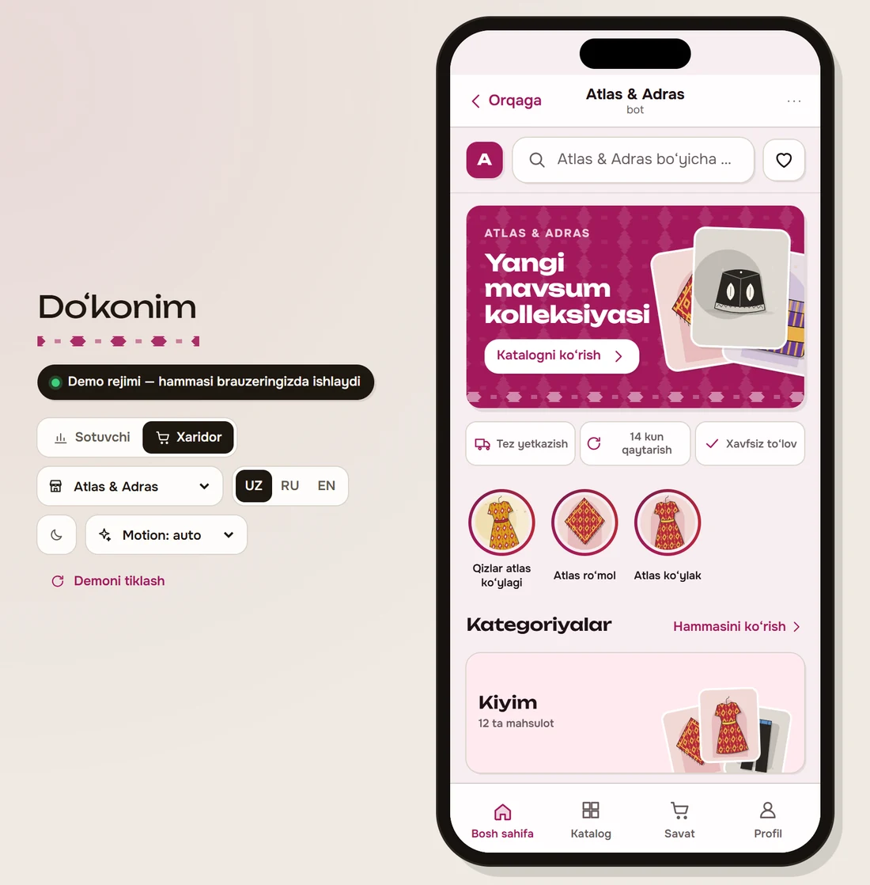
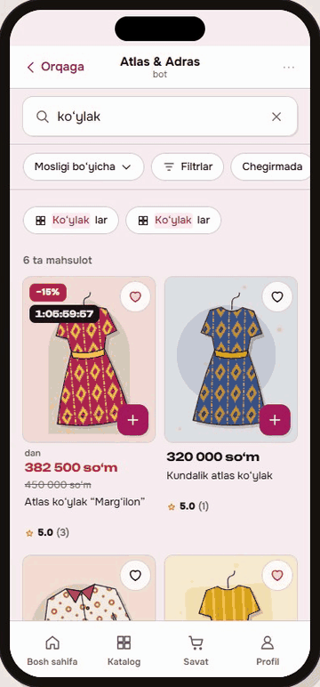
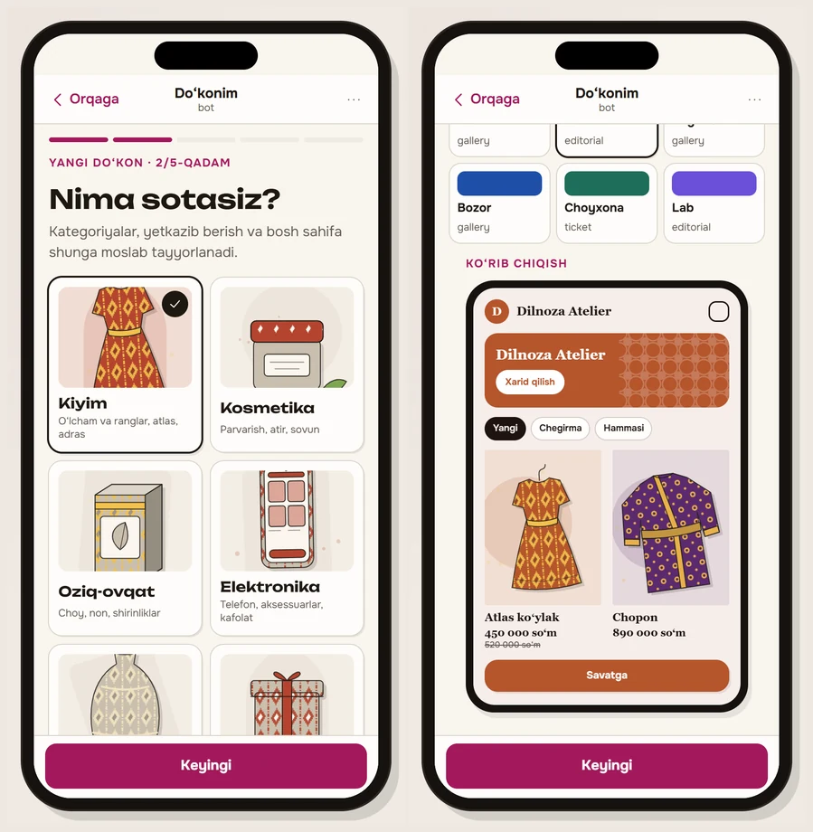
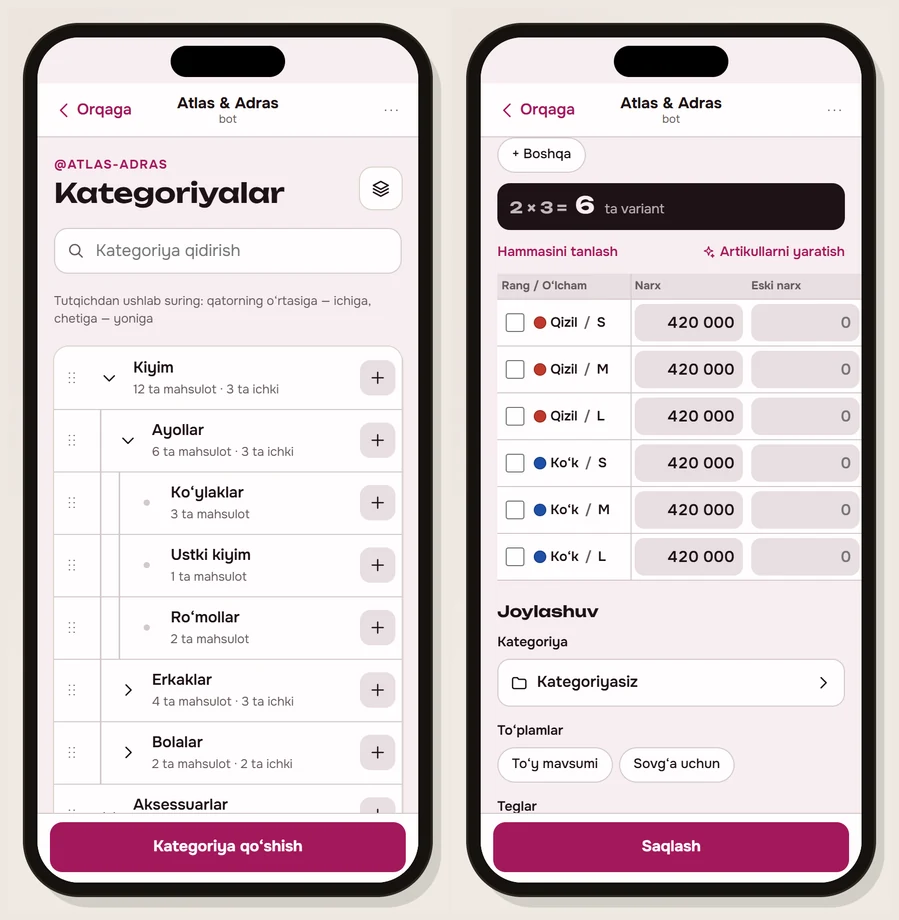
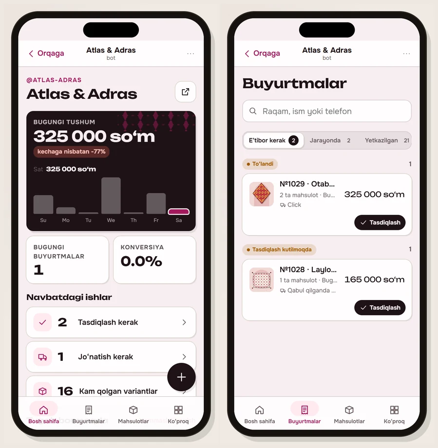
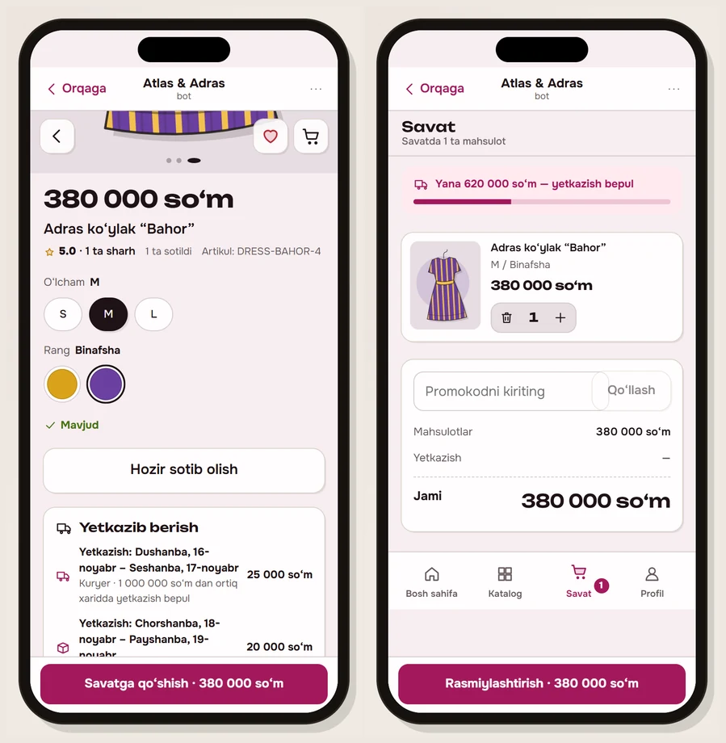
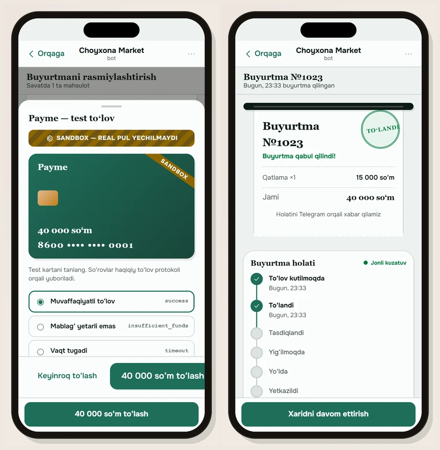
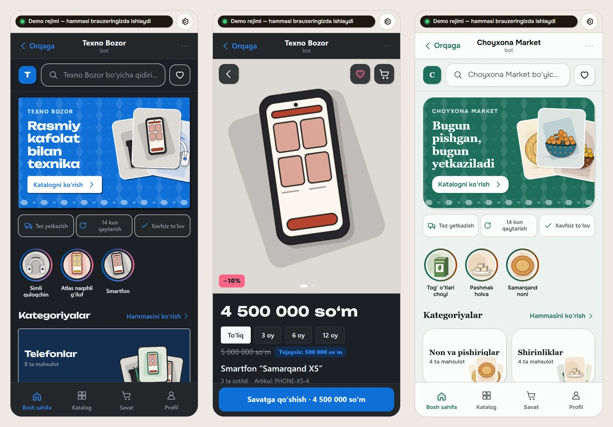

# Do'konim

[English](README.md) · [O'zbekcha](README.uz.md)

[](https://xoliddev.github.io/dokonim/)
[](https://github.com/xoliddev/dokonim/actions/workflows/ci.yml)
[](LICENSE)

Do'konim — Telegram Mini App ichida ishlaydigan, istalgan odam o'z onlayn do'konini ochishi mumkin bo'lgan platforma.
Sotuvchi botni ochadi, 5 qadamli ustadan o'tadi va unda tayyor do'kon bo'ladi:
- o'z dizayni;
- cheksiz darajali kategoriyalar;
- variantli mahsulotlar;
- chegirmalar va yetkazib berish;
- mahalliy to'lov usullari: Payme, Click, Uzum, Telegram Stars va naqd pul.

Xaridor hech narsa o'rnatmasdan Telegram ichida xarid qiladi.

Jonli demoda haqiqiy backend kodi to'g'ridan-to'g'ri brauzeringizda ishlaydi: PostgreSQL WebAssembly ko'rinishida Web Worker ichida ishga tushadi. Shuning uchun serversiz va Telegram akkauntisiz:
- do'kon yaratish;
- buyurtma berish;
- sinov rejimida to'lash;
- sotuvchi sifatida buyurtmani tasdiqlash mumkin.

Interfeys o'zbek, rus va ingliz tillarida.

<p align="center">
  
  &nbsp;
  
</p>

## Skrinshotlar

| Sotuvchi | |
|---|---|
|  |  |
| **Usta** — do'kon ko'rinishi jonli yangilanadi | **Kategoriyalar daraxti** va **variantlar jadvali** (2 × 3 = 6) |
|  | |
| **Boshqaruv paneli** va **buyurtmalar** | |

| Xaridor | |
|---|---|
|  |  |
| **Mahsulot sahifasi** va **savatcha** | **Sinov to'lovi** va **"TO'LANDI" muhri** |

<p align="center">
  
</p>

## Imkoniyatlar

### Sotuvchi uchun (`/m/:slug`)

- **Do'kon yaratish ustasi**, 5 qadamdan iborat:
  1. Nom va manzil (band yoki bo'shligi darhol tekshiriladi).
  2. Biznes turi.
  3. Brend: logotip, rang, shrift, mavzu.
  4. Birinchi mahsulot.
  5. To'lov usullari.

  Har bir o'zgarish jonli ko'rinishda darhol aks etadi. Oxirida do'kon havolasi va QR-kod beriladi.
- **Boshqaruv paneli**:
  - bugungi tushum, buyurtmalar va konversiya;
  - 7 kunlik grafik;
  - vazifalar navbati: tasdiqlash kerak bo'lgan buyurtmalar, jo'natish, kam qolgan tovarlar.
- **Mahsulotlar**:
  - qoralama, faol va arxiv holatlari;
  - har bir tilda alohida nom;
  - 3 tagacha opsiya va ulardan avtomatik tuziladigan **variantlar jadvali**;
  - ommaviy narx, eski narx va SKU tahriri.
- **Istalgan chuqurlikdagi kategoriyalar**:
  - sudrab tartiblash yoki ichiga joylash;
  - ichki kategoriya qo'shish va nomini o'zgartirish;
  - qidiruvli tanlagich orqali ko'chirish;
  - ichidagilar uchun strategiya tanlab o'chirish.

  Kategoriyani o'z ichiga ko'chirish (aylana) bloklanadi.
- **To'plamlar**: qo'lda tuziladigan yoki qoidaga asoslangan.
- **Buyurtmalar**:
  - holat bo'yicha navbat;
  - vaqt chizig'i;
  - holat mashinasi boshqaradigan o'tishlar;
  - ichki izohlar va pulni qaytarish.
- **Promo-kodlar**: foiz, qat'iy summa, bepul yetkazish, "X olsang Y bepul".
- **Sozlamalar**:
  - jonli ko'rinishli mavzu muharriri, 8 ta tayyor mavzu bilan;
  - to'lov provayderlari (sinov yoki jonli rejim);
  - yetkazish zonalari;
  - xodimlar va rollar.

### Xaridor uchun (`/s/:slug`)

- **Vitrina**: banner, hikoyalar, kategoriyalar, to'plamlar, taymerli flash-sale, mahsulot karuselllari.
- **Katalog va qidiruv**:
  - ichma-ich kategoriyalar, "non bo'laklari" yo'li bilan;
  - filtrlar: narx, mavjudligi, chegirma, reyting, rang va o'lcham;
  - saralash.
- **Mahsulot sahifasi**:
  - galereya;
  - qaysi kombinatsiya mavjudligini biladigan variant tanlagich;
  - muddatli to'lov (3, 6, 12 oy);
  - yetkazish sanasi;
  - sharhlar va o'xshash mahsulotlar.
- **O'ziga xos animatsiyalar**:
  - savatga qo'shilganda rasm savat belgisiga "uchib" boradi (The Arc);
  - katalog kartochkasi mahsulot sahifasiga silliq aylanadi.

  `prefers-reduced-motion` sozlamasi hurmat qilinadi.
- **Savatcha va bir ekranli rasmiylashtirish**: aloqa, manzil, yetkazish, to'lov.
- **Chek va kuzatuv**:
  - chek "printerdan chiqadi" va ustiga muhr bosiladi;
  - holatlar jonli yangilanadi;
  - olib ketish kodi, bekor qilish va qayta buyurtma.

## To'lovlar

Har bir do'kon o'z provayderlarini yoqadi. Kalitlar shifrlangan holda saqlanadi (`CREDENTIALS_KEK`). Har bir provayderning **sinov / jonli** rejimi bor, yangi do'konlar sinov rejimida boshlanadi.

Sinov simulyatorlari (`packages/payments/src/sandbox.ts`) provayder tomonini o'ynaydi va bizning haqiqiy webhook ishlovchilarimizni haqiqiy protokol xabarlari bilan chaqiradi:
- Payme JSON-RPC;
- Click md5 imzolari;
- Uzum Basic auth.

Pul harakatlanmaydi.

## Demoda nima haqiqiy, nima simulyatsiya

| Qism | Demoda |
|---|---|
| Ma'lumotlar bazasi | **Haqiqiy** PostgreSQL (PGlite, Web Worker, IndexedDB) |
| Sxema, migratsiyalar, RLS | **Haqiqiy**, serverdagi SQL'ning o'zi |
| Biznes mantiq | **Haqiqiy**, API ishlatadigan kodning o'zi |
| Demo ma'lumotlar | Oldindan tayyorlangan 3 do'kon, vaqti bugunga suriladi |
| Kirish | Haqiqiy HMAC algoritmi, demo kalit bilan |
| Telegram | Telegram tashqarisida simulyatsiya (telefon ramkasi, MainButton) |
| To'lovlar | Provayder tomoni simulyatsiya, pul o'tmaydi |
| Bot xabarlari | Yuborilmaydi, lekin buyurtma vaqt chizig'i jonli yangilanadi |

## Tez boshlash

```bash
npm ci
npm run build:demo                     # demo bazasini tayyorlab, demo build qiladi
npm run preview -w @dokonim/miniapp    # http://localhost:4173/dokonim/
```

API bilan ishga tushirish, Docker va barcha muhit o'zgaruvchilari jadvali [inglizcha README'da](README.md#quick-start).

## Testlar

```bash
npm test                 # barcha vitest loyihalari (477 test)
npm run lint && npm run typecheck
npm run build:demo && npm run e2e   # Playwright: 1440 px va 375 px
```

E2E testlari quyidagilarni tekshiradi:
- usta orqali do'kon yaratish;
- 3 darajali kategoriya CRUD'i;
- 2 × 3 variantli mahsulot;
- 2 ta do'konda xaridor yo'li: naqd pul va Payme sinov to'lovi.

Konsolda bitta xato chiqsa ham test yiqiladi.

## Litsenziya

[MIT](LICENSE)
